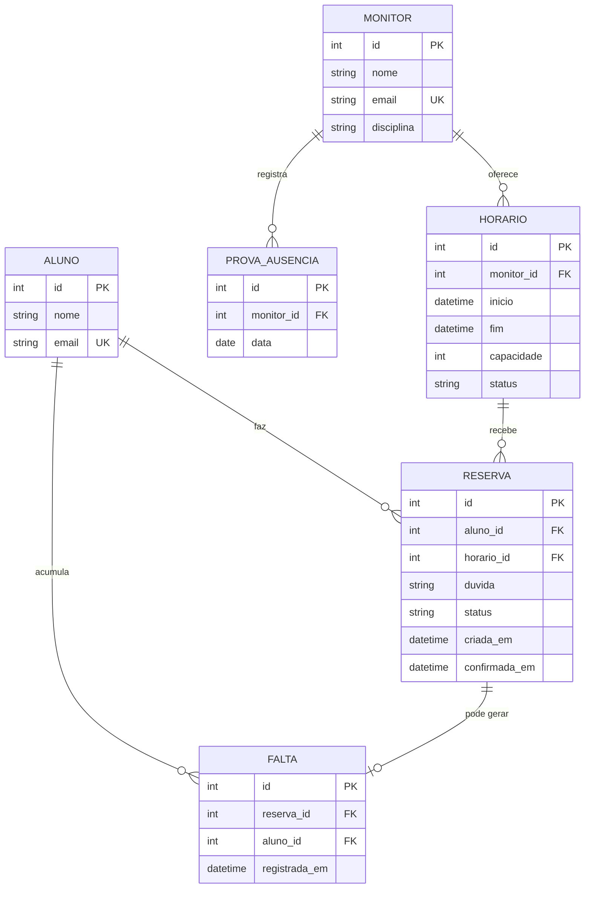
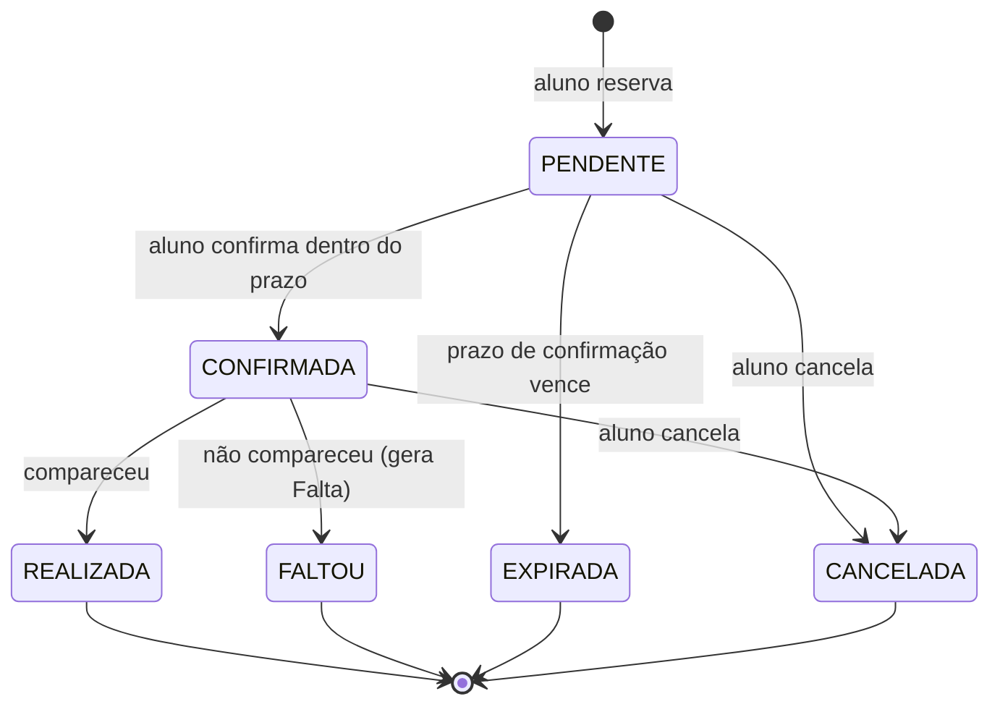

# Projeto Inicial — Sistema de Monitoria

**Etapa 2** · Responsável: Ryan · Data: 19/10
**Equipe:** Lucas Youssif Abdallah Catore · Ryan Henrique Escandelari Marcato

## Sumário

1. [Visão geral](#1-visão-geral)
2. [Decisões técnicas](#2-decisões-técnicas)
3. [Arquitetura](#3-arquitetura)
4. [Estrutura do repositório](#4-estrutura-do-repositório)
5. [Modelo de dados](#5-modelo-de-dados)
6. [Regras de negócio](#6-regras-de-negócio)
7. [Backlog e divisão de trabalho](#7-backlog-e-divisão-de-trabalho)
8. [Estratégia de testes](#8-estratégia-de-testes)

---

## 1. Visão geral

**Problema:** organização da disponibilidade da monitoria.

**Solução:** sistema que gerencia a relação entre horários, monitores e alunos.

**Funcionamento resumido:**

- O sistema lista monitores e horários disponíveis em blocos de 30 minutos.
- O aluno reserva um bloco e descreve sua dúvida; o monitor analisa e, se possível, atende em grupo.
- O monitor registra até 2 datas de prova em que estará ausente.
- O aluno deve confirmar presença com antecedência; se confirmar e faltar, a falta é registrada.
- O sistema gera relatório das dúvidas apresentadas e das horas trabalhadas pelo monitor.

---

## 2. Decisões técnicas

| Item | Decisão | Justificativa |
|------|---------|---------------|
| Linguagem | Python 3.10+ | Definido no plano de execução. |
| Interface | CLI (menu interativo) | Prazo curto (19–22/10): foco nas regras de negócio. |
| Persistência | SQLite (`sqlite3` da biblioteca padrão) | Sem instalação extra, arquivo único, suporta SQL e relacionamentos. |
| Testes | `pytest` | Testes unitários por módulo + teste integrado do fluxo. |
| Metodologia | Scrum, 1 sprint (19/10–22/10), dailys no Discord | Definido no plano. |
| Versionamento | Git, branch por funcionalidade, merge na `main` via PR | Rastreabilidade e revisão cruzada. |

> A camada de serviços não depende da CLI; uma interface web (ex.: Flask) pode ser acoplada depois sem reescrever as regras.

---

## 3. Arquitetura

Arquitetura em **camadas**, com dependência apenas de cima para baixo.

```
┌──────────────────────────────────────────────────────────┐
│ Interface        cli.py        entrada/saída do usuário  │
├──────────────────────────────────────────────────────────┤
│ Serviços         services/     regras de negócio         │
│                  agendamento · confirmacao · provas ·    │
│                  relatorio                               │
├──────────────────────────────────────────────────────────┤
│ Persistência     database.py   conexão SQLite + schema   │
├──────────────────────────────────────────────────────────┤
│ Modelos          models.py     dataclasses + enums       │
└──────────────────────────────────────────────────────────┘
```

**Responsabilidades**

| Camada | Arquivo(s) | Responsabilidade | Não deve |
|--------|-----------|------------------|----------|
| Interface | `cli.py` | Exibir menus, ler entradas, mostrar mensagens e erros. | Conter regra de negócio ou SQL. |
| Serviços | `services/*.py` | Aplicar regras (RN01–RN08), orquestrar operações, lançar `RegraDeNegocioError`. | Usar `print`/`input`. |
| Persistência | `database.py` | Abrir conexão, criar schema, executar consultas. | Decidir regras de negócio. |
| Modelos | `models.py` | Definir entidades (dataclasses) e enums de status. | Acessar banco ou interface. |
| Apoio | `config.py`, `erros.py` | Constantes (bloco, capacidade, prazo) e exceção de domínio. | — |

---

## 4. Estrutura do repositório

```
monitoria/
├── README.md
├── requirements.txt
├── .gitignore
├── docs/
│   ├── historias_usuario.md
│   └── projeto_inicial.md
├── src/
│   └── monitoria/
│       ├── __init__.py
│       ├── config.py          # constantes (duração do bloco, capacidade, prazo)
│       ├── models.py          # dataclasses e enums
│       ├── database.py        # conexão e schema SQLite
│       ├── erros.py           # RegraDeNegocioError
│       ├── cli.py             # menu interativo
│       └── services/
│           ├── __init__.py
│           ├── agendamento.py
│           ├── confirmacao.py
│           ├── provas.py
│           └── relatorio.py
└── tests/
    ├── test_database.py
    ├── test_agendamento.py
    ├── test_confirmacao.py
    ├── test_provas.py
    ├── test_relatorio.py
    └── test_fluxo_completo.py
```

---

## 5. Modelo de dados

### 5.1 Diagrama entidade-relacionamento



### 5.2 Entidades

| Entidade | Descrição | Observações |
|----------|-----------|-------------|
| **Aluno** | Quem reserva atendimentos. | `email` único. |
| **Monitor** | Quem atende. | `email` único; possui `disciplina`. |
| **Horário** | Bloco de 30 min oferecido por um monitor. | `fim = inicio + 30 min`; `capacidade` padrão 5 (grupo). |
| **Reserva** | Pedido do aluno para um horário, com a dúvida. | Segue o ciclo de status da seção 5.3. |
| **Falta** | Ausência de aluno que havia confirmado. | Ligada 1–1 à reserva (RN07). |
| **ProvaAusencia** | Data de prova em que o monitor estará ausente. | Máx. 2 por monitor (RN08). Apoia o módulo "provas do monitor". |

### 5.3 Ciclo de status

**Reserva**



**Horário:** `DISPONIVEL` → `LOTADO` (capacidade atingida) · `CANCELADO` (monitor indisponível).

> Os nomes dos status são uma proposta e devem ser ajustados às histórias de usuário, se divergirem.

---

## 6. Regras de negócio

As regras RN07 e RN08 já estavam referenciadas no modelo; as demais foram derivadas do plano de execução. Revisar com `historias_usuario.md` para alinhar a numeração.

| ID | Regra | Módulo |
|----|-------|--------|
| RN01 | Todo horário tem duração fixa de 30 minutos. | agendamento |
| RN02 | O aluno só reserva horários `DISPONIVEL` e informa a dúvida (obrigatória). | agendamento |
| RN03 | O horário aceita reservas até a `capacidade` (padrão 5); depois fica `LOTADO`. | agendamento |
| RN04 | Um aluno não pode ter duas reservas ativas no mesmo horário. | agendamento |
| RN05 | O aluno confirma presença até o prazo definido em `config.py`, antes do início. | confirmacao |
| RN06 | Reserva não confirmada no prazo passa a `EXPIRADA`, liberando a vaga. | confirmacao |
| RN07 | Aluno que confirmou e não compareceu gera exatamente uma `Falta` por reserva. | confirmacao |
| RN08 | Cada monitor registra no máximo 2 datas de prova com ausência; não há horários nessas datas. | provas |
| RN09 | O relatório lista as dúvidas por horário/monitor e soma as horas trabalhadas (30 min × atendimentos realizados). | relatorio |

---

## 7. Backlog e divisão de trabalho

Sprint única: **19/10 a 22/10**. Um módulo por integrante, conforme o plano de execução.

| Prioridade | Item | Módulo | Responsável (sugestão) | Prazo |
|:---:|------|--------|------------------------|-------|
| 1 | Base: `config`, `models`, `database`, `erros` | núcleo | Ryan | 19/10 |
| 2 | Listar horários e reservar com dúvida | agendamento | Lucas | 20/10 |
| 3 | Confirmar presença e registrar faltas | confirmacao | Ryan | 20/10 |
| 4 | Registrar datas de prova do monitor | provas | Lucas | 21/10 |
| 5 | Relatório de dúvidas e horas trabalhadas | relatorio | Ryan | 21/10 |
| 6 | Menu CLI integrando os módulos | cli | Lucas e Ryan | 21/10 |
| 7 | Teste integrado e correção de bugs | testes | Lucas | 21/10 |
| 8 | README, revisão final e entrega | documentação | Ryan | 22/10 |

**Definição de pronto (DoD):** funcionalidade implementada, teste unitário passando, PR revisado pelo outro integrante e documentação do módulo atualizada.

---

## 8. Estratégia de testes

- **Unitários:** um arquivo por módulo, usando banco SQLite em memória (`:memory:`) para isolar cada teste.
- **Integrado:** `test_fluxo_completo.py` cobre o fluxo ponta a ponta: cadastrar monitor → criar horário → reservar → confirmar → registrar falta → gerar relatório.
- **Regras:** cada RN deve ter ao menos um teste de caso válido e um de violação (`RegraDeNegocioError`).
